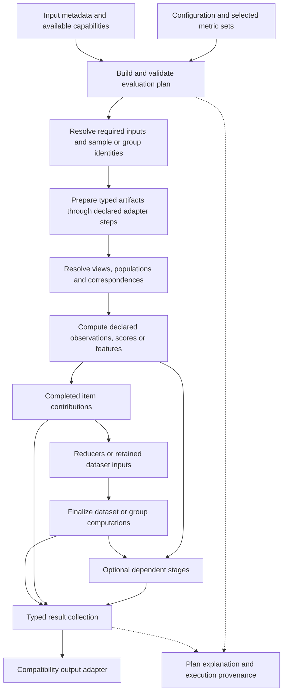

# Feature request: a unified evaluation framework

Status: proposed for a future release. This document specifies an architectural
change; it does not introduce a new API or change evaluation behavior.

## Recommendation

Use a **modality-agnostic evaluation lifecycle with modality-aware preparation,
observations and metric definitions**. Represent each evaluation as an explicit
plan of typed steps and dependencies. The same plan should drive computation,
aggregation, explanations and output metadata.

Depth, RGB, rays and point clouds can share this lifecycle without sharing one
preprocessing function, validity mask or mathematical reduction. A metric may
consume several modalities, a whole image, two point sets, a group of frames or
dataset-wide features. Those requirements belong in its definition.

Start with ordinary Python data classes, protocols and a small dependency
executor. Keep the current CLI and library entry points as compatibility
wrappers while moving their computation into the shared framework.

## Problem and motivation

Today, adding a core metric requires wiring computation and storage in
[`evaluate.py`](../euler_eval/evaluate.py), descriptions and paths in
[`cli.py`](../euler_eval/cli.py), and sometimes separate per-file and dataset
serialization logic. Deferred CPU/GPU batch results also patch mutable output
dictionaries. The distribution contract is attached through a later tree walk
in [`distribution_contract.py`](../euler_eval/distribution_contract.py).

This makes several questions difficult to answer from one place:

- Which transformed prediction and GT does a metric consume?
- Which observations are included, and when is that selection applied?
- Is a dataset result a mean of image scores, a pooled observation statistic,
  or a computation over the dataset as a whole?
- Do a scalar and its associated distribution describe the same population?
- When is a deferred result complete, and which accumulators receive it?

The recent depth benchmark-range fix is a concrete example: the default
distribution needed its selection explicitly connected to the benchmark
population after sky-depth processing. Shared population definitions should
make that relationship part of the plan.

As a metric author, I should be able to declare inputs, computation, supported
reductions and result semantics once. As a user, I should be able to inspect
how any emitted result was produced. As a consumer, euler-view should receive
stable output with enough provenance to distinguish incompatible evaluations.

## Unified flow

This is a lifecycle overview. An individual plan is a directed acyclic graph:
preparation may itself require correspondence construction before alignment,
and later metrics may consume artifacts or results from earlier stages. The
diagram does not mandate that every metric executes every box.

For example, RGB plus GT depth can produce depth-binned photometric scores;
depth plus calibration can produce a point map; a future reconstruction stage
can consume several frames and produce a cloud for geometric evaluation.
Each dependency must be explicit, including its coordinate system and scope.

## Responsibilities and contracts

The initial implementation should formalize these concepts. Names below are
design suggestions, not a promised public Python API.

| Concept | Required responsibility |
|---|---|
| `EvaluationPlan` and step definitions | Requested outputs, typed dependencies, execution scope, effective policies and implementation versions. Validate unsupported combinations and cycles before expensive work. |
| Artifact specification and reference | Payload kind, GT/prediction role, source identity, units, coordinate frame, spatial layout, transformation lineage and ownership. A reference may point to memory or managed storage. |
| View and population definitions | Evaluated representation, eligibility predicates, selection order, correspondence policy and observation unit. Record distinct source and target populations where needed. |
| `MetricSpec` | Required artifacts or observations, computation, validity requirements, parameters, supported scopes/reducers and semantic descriptions. Metric sets select these definitions. |
| `ReducerSpec` | Accepted contribution type, state, update/finalize operations, merge capability, weighting, precision and retention requirements. |
| Contribution and result records | Stable request/item identity, payload, status, counts and provenance references. Results are completed values; pending work belongs to execution state. |

The shared core owns planning, dependency resolution, resource lifetime,
batch completion, aggregation and result collection. It dispatches by declared
capabilities and contracts. Modality-specific adapters and metric kernels own
geometry, image preprocessing, feature extraction and domain-specific math.

Metric definitions should supply descriptions, units and allowed reductions to
the exporter. Adding a metric using existing capabilities should not require
new modality conditionals in the executor or manual CLI output-tree assembly.

### Inputs and execution scope

Treat the required inputs as named roles, rather than assuming every operation
takes a `(prediction, GT)` array pair. Support declarations for:

- One item: paired images, predicted image alone, ray maps, or two point sets.
- A group: a scene, sequence, temporal window or another explicitly identified
  collection, including any ordering requirement.
- A dataset: feature collections, accumulated statistics or other retained
  inputs needed after the item stream completes.

An execution batch is a performance choice, not a statistical grouping. A
batch size must not silently define a sample, population or dataset reducer.

Each request identifies its matching/join policy and required modalities. A
missing optional modality should affect the requests that need it; it should
not silently shrink unrelated evaluation populations. Preserve existing
matching behavior during migration, and make any change to that behavior an
explicit, separately tested semantic change.

NIQE/FADE kernels require predictions only, although today's RGB evaluation
workflow pairs GT and predictions. Express that kernel requirement now;
enabling a standalone prediction-only CLI workflow can be a separate feature.

### Artifacts, views and populations

An artifact must carry enough information to reject invalid combinations:
metres versus unspecified relative values, incompatible coordinate frames,
unaligned image grids, or sparse samples supplied to dense-neighbourhood
metrics. Calibration assumptions and inferred input spaces must be recorded.

A population is a named selection over a declared observation domain. It need
not be a dense Boolean mask: it may be projected correspondences, valid
directions, selected images, or a directed set of nearest-neighbour queries.
Two populations with the same display name are not automatically compatible.

Separate fitting and scoring populations. For depth, the current intended
order must remain explicit:

1. Spatial preparation, calibration handling and planar/radial conversion.
2. Alignment fitting on its declared fitting population, where requested.
3. GT/prediction sky-depth capping and predicted-sky filling under the existing
   policy, with GT sky exclusion recorded separately.
4. Scoring validity and benchmark membership on evaluated GT. The benchmark
   `all` interval includes both endpoints.
5. Scalar and distribution computations for the selected space/population.

An unrestricted scalar and a benchmark-filtered histogram may intentionally
coexist, as they currently do. Their internal identities must expose that
difference. Scalar and distribution requests for the *same* population must
consume the same selected observations.

Additional requirements such as positive inputs for logarithms or a valid
neighbourhood for normals belong to the relevant computation. Explicitly name
the resulting population or support policy. Likewise, RGB sky filling and
RGB pixel exclusion are different operations; the framework must preserve
that distinction and the current unfilled inputs used for NIQE/FADE.

## Mapping current modalities into the framework

| Evaluation family | Preparation and dependencies | Computation and scope |
|---|---|---|
| Dense depth | Spatial alignment, intrinsics, radial/planar conversion, optional affine fitting, sky policy and benchmark populations | Corresponding-pixel errors and standard reducers; dense geometry; image scores; dataset feature metrics |
| Sparse depth | Point-cloud transforms, projection, visibility/collision policy, depth preparation and alignment | Errors at evaluated projected correspondences; dense-neighbourhood metrics remain unavailable |
| RGB | Image layout/range handling, spatial alignment and metric-specific sky policy | Pixel errors, local/image scores, prediction-only quality kernels and dataset FID |
| RGB with depth | RGB inputs plus explicitly registered GT depth and calibration | Photometric observations selected by GT depth; demonstrates an existing metric with multiple modalities |
| Rays | Direction preparation, spatial alignment, validity and resolved FoV policy | Angular observations, thresholds and accuracy curves; declared exact/approximate summaries |
| Dense points-3D | Point maps or unprojected depth, coordinate-frame handling and optional gauge fitting | Correspondence errors, radial/lateral decomposition, dense geometry and separate cloud comparisons |
| Sparse points-3D | Sparse cloud visibility and projection plus predicted points or the existing programmatic depth conversion | Correspondence errors and cloud queries with explicitly declared directions |

Preserve current entry-point eligibility: representing an existing library
conversion in the plan does not automatically enable an additional CLI result
family. For point-map metrics, also preserve computations intentionally made in
the native frame even when aligned results are available.

Correspondence error and cloud distance require different observations.
Nearest-neighbour cloud queries must declare their source, target, direction
and subsampling policy. Current sparse fixed-threshold diagnostics are
GT-to-prediction completeness/recall, while optional F-score AUC also needs the
reverse direction. Keep those requirements separate. Do not pool points from
unrelated frames before nearest-neighbour matching; a scene-level comparison
would require an explicit scene artifact and common coordinate frame.

The ray evaluator already uses a histogram approximation for its pooled
median. Migrating it must preserve and disclose that approximation instead of
implicitly promising an exact quantile.

## Observations and aggregation

Share computations only when their full input, view, population and numerical
policies match. Reuse references or chunks where practical; the framework
must not require retaining all pixel errors in memory.

A scalar, histogram and curve are different outputs derived from declared
observations. A depth histogram associated with `rmse` bins absolute residuals;
the points-3D counterpart bins Euclidean correspondence errors. Neither is a
distribution of repeated estimates of dataset RMSE.

| Requested result | Contribution/state | Final computation |
|---|---|---|
| Pixel-pool depth RMSE | Squared-error sum and valid count | `sqrt(sum_sq / count)` |
| Mean per-image RMSE | Valid image RMSE sum and image count | Divide; preserve equal image weighting |
| Error-magnitude histogram | Fixed-bin counts | Elementwise sum |
| Error sum by GT-depth bin | Fixed-bin error sums | Elementwise sum |
| RMSE by GT-depth bin | Squared-error sums and counts for matching bins | Square root of each bin's mean squared error |
| Exact quantile | Retained values or another exact supported state | Quantile over the declared population |
| LPIPS dataset mean | Completed per-image scores and validity | Declared image-score reducer |
| FID | Compatible GT/prediction feature collections, or sufficient feature moments if supported by that backend | One dataset-level calculation after ingestion |
| KID | Feature collections plus declared subset selection/seed policy | Dataset-level estimator with its required retained state |

All reducers have `update` and `finalize`; only reducers declaring a compatible
merge operation may combine partial states. State may be sufficient statistics,
retained values or ordered/global inputs. Do not force all reducers into sums
or average finalized shard scores. In particular, per-shard FID values cannot
be averaged to obtain dataset FID. Backend-specific feature preprocessing,
model weights and covariance conventions are part of FID compatibility.

Define merge compatibility from the complete resolved semantics: observation,
units, view, population policy, reducer, bin edges/intervals, implementation
and estimator settings. Registry IDs and matching output paths alone are
insufficient. Check partition identity separately so overlapping inputs are
not double counted. Integer counts must remain exact; floating accumulation
and backend equivalence require declared tolerances.

For matching populations and fixed bins, dataset histogram counts must equal
the sum of item contributions. Benchmark subsets and canonical aliases must
not be accumulated again as additional observations. Exact RMSE continues to
use sufficient statistics, independently of histogram resolution.

## Execution and later stages

Compile selected requests into explicit dependencies. Resolve metadata-based
choices early; leave data-dependent choices marked unresolved until the
required input is available, then record the decision and its policy. Reject
missing required capabilities and incompatible artifacts with useful messages.

CPU kernels, GPU batches and dataset computations should emit typed completed
contributions into the same coordinator. Completion is tracked per logical
request and item/group; each contribution reaches its reducer once. A failed
or retried batch must not duplicate counts. Exported dictionaries must not be
used as pending-result storage.

Define `ok`, `no_observations`, `skipped`, `unavailable` and `failed` outcomes
with reasons and relevant counts. Empty or failed measurements must not enter
means as zero. The plan declares whether a failure stops the run or leaves a
result unavailable, preserving existing failure behavior during migration.

Use bounded queues and explicit artifact ownership. Release intermediates
after their consumers finish; declare temporary-file/feature retention and
clean it up on completion or failure. Expensive optional metrics should only
load models and compute features when selected. Shared preparation should not
force an entire dataset or all modalities into memory.

Allow a later stage to consume an earlier artifact or typed result through a
declared dependency. Examples include frame fusion followed by cloud scoring,
temporal metrics over ordered frame groups, and summaries derived from
completed dataset results. Specify group membership, ordering, frame transforms
and missing-input behavior. These examples are extension requirements, not
requests to implement reconstruction or temporal metrics in this refactor.

Initially, a local dependency executor is sufficient. A distributed scheduler,
plugin marketplace and user-authored workflow language are outside this
feature's scope. Merge contracts prepare suitable computations for later
parallel execution without making distribution a prerequisite.

## Transparency and output compatibility

Provide a proposed `--explain` mode and a programmatic plan description. They
should identify inputs, transforms, fitting/scoring populations, computation
dependencies, scope, reducer, approximation and requested output paths.
An explanation that does not evaluate data must mark inferred settings as
pending. Runtime provenance records resolved choices and contribution counts;
it should be possible to follow an output back to its plan definition without
dumping arrays or masks.

Use a structured internal result identity containing evaluation family, view,
population, measurement, reducer, scope/group and output kind, referencing the
resolved semantic definitions. A path is an export representation of that
identity. Canonical aliases reference existing results and perform no work.

Keep the current `eval.json` envelope, per-modality files, metric paths, aliases,
library return shapes, and distribution v1 leaves/registry during migration.
One serialization layer should translate typed results to those contracts.
Generate descriptions from metric definitions rather than rediscovering
semantics through dictionary names. Keep transport validation, including
JavaScript-safe integer counts and nonfinite-value handling, at that boundary.

Preserve existing `distributionPopulation` metadata. A later, separately
versioned provenance extension can describe per-result views and populations
for all output kinds, including scalar results. Distinguish evaluation
semantics versions from wire-schema versions: an internal refactor must not
silently change metric meaning, and a new meaning does not justify pretending
older results used the new policy.

euler-view should be able to ingest compatibility output without changes.
Future provenance can support richer explanations and comparison checks, but
this feature request contains no euler-view implementation work.

## Delivery plan

1. **Characterize existing behavior.** Inventory current metric definitions,
   requirements, populations, reduction rules, aliases and exceptions. Capture
   representative existing outputs and numerical behavior, including known
   policy differences between CLI and training validation.
2. **Introduce the contracts through depth.** Extract prepared observations,
   explicit populations and standard/distribution reducers. Reuse the
   sufficient-statistic foundation in
   [`depth_standard.py`](../euler_eval/metrics/depth_standard.py) and the typed
   sample/aggregator approach in [`validation.py`](../euler_eval/validation.py).
   Move dense and sparse depth plus training validation onto the same core
   where semantics match. Keep heavyweight optional metrics outside the
   lightweight validation API.
3. **Validate the design against different computations.** Migrate RGB image
   and prediction-only kernels, LPIPS completion, dataset FID/KID paths where
   supported, and RGB-with-depth metrics. This milestone must demonstrate
   image, dataset and multiple-modality dependencies before treating the
   abstraction as stable.
4. **Migrate rays and points.** Preserve frame choices, directional cloud
   comparisons, sparse eligibility and approximation policies. Share declared
   preparation where compatible and retain specialized kernels.
5. **Complete explanations and remove duplicate wiring.** Generate result
   descriptions and compatibility output from definitions. Document how to
   add a metric, adapter and reducer. Stabilize extension contracts only after
   the current modalities exercise them.

Each milestone must leave the existing entry points usable. Numerical or
selection-policy corrections discovered during migration should be reviewed,
tested and release-noted separately from structural changes.

## Acceptance criteria

- All current evaluation families use the same planning, contribution and
  result lifecycle while preserving modality-specific preparation.
- A metric using existing artifact and reducer types can be added through its
  kernel and declaration without editing the executor or CLI tree-building
  logic. Its descriptions and supported output forms come from that definition.
- Plans cover a pixel metric, an image metric, a prediction-only kernel, a
  dataset feature metric and a metric requiring RGB plus depth. A small test
  stage can consume an upstream artifact/result without adding a scheduler
  branch for that modality.
- Depth parity cases cover dense/sparse inputs, native/aligned spaces,
  planar/radial conversion, benchmark boundaries, sky capping/filling,
  excluded/invalid inputs and empty populations. Fitting and scoring
  populations are independently inspectable.
- Scalars and distributions requesting the same population agree on selected
  observations. Fixed-bin dataset counts equal summed item counts, and
  aliases/subset summaries do not double count.
- Reducer tests distinguish pooled RMSE from mean image RMSE, verify compatible
  partition merging, reject incompatible state merges and preserve exact or
  approximate quantile policies. Dataset metrics are finalized at their
  declared scope instead of averaging arbitrary batch/shard scores.
- Cloud tests preserve coordinate frames, correspondence/nearest-neighbour
  distinctions, sparse directions and subsampling. RGB tests preserve filled
  versus unfilled inputs and dependencies on optional depth.
- CPU and batched implementations agree within metric-specific tolerances;
  integer histograms agree exactly. Completion-order tests detect lost or
  duplicated contributions, including failures and empty results. Stochastic
  estimator checks use declared seed/subset policies.
- Public CLI/library compatibility fixtures retain result paths, aliases,
  values within the existing tolerances, metadata and distribution v1 schema
  validity. Changes in eligibility, weights or semantics are explicit changes.
- Explanation output identifies effective policies and unresolved choices;
  result provenance includes resolved dependencies, counts and outcome reasons.
- Streaming checks demonstrate bounded intermediate memory for streaming
  reducers and cleanup of retained resources. Existing tests remain usable
  without datasets, network access or a GPU; backend stubs can exercise
  scheduling and feature contracts.

## Design boundary

The framework should make the computation inspectable and extensible through
shared contracts. It should preserve specialized mathematical kernels and
make their differences visible. Its success is measured by fewer independent
places to wire a metric, demonstrable scalar/distribution population agreement,
and the ability to express the current non-pixel and dataset computations
within the same lifecycle.
